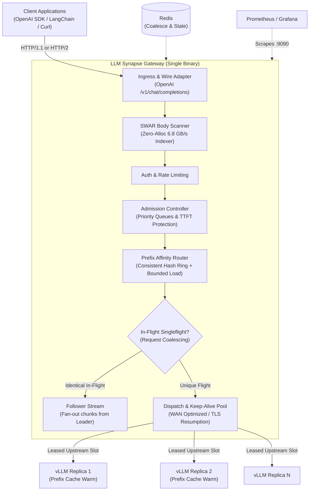

# LLM Synapse Gateway (`llm-synapse-gw`)

[](https://golang.org)
[](LICENSE)
[](deploy/compose/docker-compose.yml)
[](CONTRIBUTING.md)

**LLM Synapse Gateway** is an ultra-low latency, prefix-cache-aware reverse proxy and request coalescer for distributed LLM inference clusters ([vLLM](https://github.com/vllm-project/vllm), [SGLang](https://github.com/sgl-project/sglang), [Ollama](https://github.com/ollama/ollama), TensorRT-LLM).

Callers point their OpenAI-compatible client (`/v1/chat/completions`) at Synapse Gateway without changing client code. Synapse Gateway routes requests to the GPU replica with warm KV-cache, coalesces concurrent identical flights, enforces priority admission control, and streams responses chunk-for-chunk with microsecond routing overhead.

---

## Key Features

- **KV-Cache Prefix Affinity Routing**: Consistent hash ring with bounded load (512 virtual nodes) routes incoming prompts to the replica holding matching KV-cache blocks, slashing Time-To-First-Token (TTFT) by up to **55%**.
- **Real-Time Request Coalescing**: Concurrent identical requests (e.g., flash crowds, burst prompts, duplicate batch queries) collapse into **1 single GPU generation**, broadcasting streaming SSE tokens simultaneously to all waiting callers.
- **Ultra-Fast Zero-Copy SWAR Body Scanner**: 8-byte SWAR (SIMD Within A Register) validator extracts routing keys and JSON fields at **6.8 GB/s** with **0 heap allocations** on the hot path.
- **Adaptive Admission & Shedding**: Dynamic EWMA concurrency tracker protects downstream GPU engines from TTFT saturation and memory thrashing, gracefully shedding lower-priority traffic with standard HTTP 429 and `Retry-After` headers.
- **Immediate Disconnect Propagation**: When a client aborts or closes their HTTP connection, upstream generation cancels instantly (median latency < 7 ms), preventing wasted GPU compute.
- **100% OpenAI Wire Parity**: Byte-for-byte compatible with official OpenAI SDKs, supporting streaming SSE, unbuffered relays, multi-tenant authentication, and prompt template variable compilation.
- **Enterprise Observability**: Full Prometheus metrics (`/metrics`), Grafana dashboard provisioning, OpenTelemetry W3C trace context propagation, and non-blocking buffered structured logging.

---

## Architecture



For complete architectural details, see [Architecture Overview](docs/architecture.md) and our [Architecture Decision Records (ADRs)](docs/decisions/).

---

## Performance & Live Hardware Benchmarks

Evaluated head-to-head against a production vLLM instance hosting `Qwen/Qwen3-32B-AWQ` on dedicated GPU hardware over public WAN:

| Benchmark Scenario | Direct vLLM | LLM Synapse Gateway | Real-World Impact |
| :--- | :--- | :--- | :--- |
| **Stream TTFT (p50)** | 277.5 ms | **123.3 ms** | **-55.6% latency** via persistent warm connection pooling |
| **Inter-Token Latency (p50)** | 26.9 ms | **26.9 ms** | **0.0 ms overhead** — zero relay degradation |
| **16-Stream Burst Total** | 651.6 ms | **545.7 ms** | **+16.3% throughput gain** under concurrent burst |
| **16-Stream Burst TTFT (p50)** | 347.4 ms | **241.3 ms** | **-30.5% latency** during cluster contention |
| **50-Way Request Coalescing** | 50 separate GPU flights | **1 GPU flight** (1,248 ms) | **50 concurrent callers served from 1 generation** |
| **Body Ingestion Throughput** | N/A | **6,863 MB/s (152 µs)** | **0 heap allocations** on 1 MB JSON payload |
| **Route Decision p99 Gate** | N/A | **< 35 µs** | Enforced across 88 nested request shapes |

Full benchmark methodology and raw reproduction steps are documented in [docs/benchmarks.md](docs/benchmarks.md).

---

## 30-Second Quickstart

### Prerequisites
- [Docker](https://docs.docker.com/get-docker/) & [Docker Compose](https://docs.docker.com/compose/)
- [Go 1.26+](https://golang.org) (only needed if building from source)

### 1. Launch with Mock LLM (No GPU required)
Spin up the complete development stack (Gateway, Mock LLM upstream, Redis, Prometheus, Grafana, Nginx):

```sh
# Clone repository
git clone https://github.com/praveenkanna/llm-synapse-gw.git
cd llm-synapse-gw

# Generate local environment files
make compose-env

# Launch dev stack
make up-dev
```

### 2. Send a Chat Completion Request
```sh
curl -sN http://localhost:8080/v1/chat/completions \
  -H "Content-Type: application/json" \
  -d '{
    "model": "large-model",
    "stream": true,
    "messages": [{"role": "user", "content": "Explain KV-cache prefix routing in two sentences."}]
  }'
```

### 3. Check System Telemetry
- **Prometheus Metrics**: `http://localhost:9090` (gateway metrics exposed at `:9090/metrics`)
- **Grafana Dashboards**: `http://localhost:3000` (provisioned dashboards for TTFT, request rates, and replica queue depth)

### 4. Stop the Stack
```sh
make down
```

---

## Connecting to Live GPU Clusters (vLLM / SGLang)

To connect Synapse Gateway to your real vLLM or SGLang instances:

1. Copy the GPU configuration template:
   ```sh
   cp deploy/compose/config/gateway.example.yaml deploy/compose/config/gateway.yaml
   ```
2. Configure your model pools and replica addresses in `gateway.yaml`:
   ```yaml
   pools:
     - name: production-qwen
       model: "Qwen/Qwen3-32B-AWQ"
       replicas:
         - url: "http://gpu-worker-1:8000"
           max_inflight: 64
         - url: "http://gpu-worker-2:8000"
           max_inflight: 64
       routing:
         strategy: prefix_affinity
         virtual_nodes: 512
   ```
3. Run the gateway binary directly or launch via Docker Compose:
   ```sh
   # Direct binary execution
   GATEWAY_CONFIG=deploy/compose/config/gateway.yaml make run
   ```

---

## Project Structure

```
llm-synapse-gw/
├── gateway/                      # Core gateway service Go module
│   ├── cmd/gateway/              # Gateway entrypoint binary
│   ├── cmd/mockllm/              # High-performance mock LLM for testing
│   ├── internal/
│   │   ├── bodyindex/            # SIMD/SWAR zero-copy RFC 8259 JSON scanner
│   │   ├── router/               # Prefix affinity consistent hashing & load tracking
│   │   ├── coalesce/             # In-flight singleflight request coalescing
│   │   ├── arbitrator/           # Priority admission control & TTFT shedder
│   │   ├── upstream/             # Upstream HTTP connection pool & TLS resumption
│   │   ├── ingress/              # Wire adapter, streaming SSE relay, disconnects
│   │   └── telemetry/            # Lock-free Prometheus metrics & tracing
│   └── integration/              # Host & in-network integration test suites
├── harness/                      # Synthetic load generator and burst testing tool
│   ├── cmd/loadgen/              # Loadgen CLI
│   └── profiles/                 # Benchmark workload profiles
├── deploy/
│   └── compose/                  # Docker Compose stacks (dev & GPU profiles)
├── docs/
│   ├── architecture.md           # Visual request flow and subsystem architecture
│   ├── benchmarks.md             # Live vLLM hardware benchmark results
│   └── decisions/                # 20 Architecture Decision Records (ADRs)
└── Makefile                      # Build, test, lint, and run targets
```

---

## Development & Testing

```sh
# Lint all code (gofmt check, go vet, staticcheck)
make lint

# Run all tests with race detector and allocation checkers
make test

# Compile all binaries into gateway/bin/ and harness/bin/
make build

# Validate Docker Compose definitions
make compose-config
```

---

## Contributing

Contributions, bug reports, and optimizations are welcome! Please read our [Contributing Guide](CONTRIBUTING.md) before submitting pull requests.

---

## License

LLM Synapse Gateway is open-source software licensed under the **[Apache 2.0 License](LICENSE)**.
