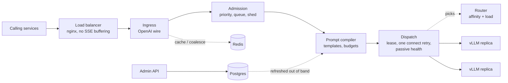

# Architecture

One Go binary, two surfaces: the **request path** (every call, optimized for microseconds and predictable memory) and the **admin API** (templates and policy; never touches a request).

## Request flow



Every stage can be bypassed. If a stage fails, the request continues to the next stage unchanged and the skip is recorded (fail open).

## Wire-compatibility notes

Places where the gateway's wire behaviour is deliberate and might surprise someone comparing it with vLLM directly:

- **401 before 404 under `/v1/`.** With `auth.enabled: true`, every `/v1/*` request is authenticated before routing. Without a valid token, unknown paths (`/v1/embeddings`) and wrong methods (`GET /v1/completions`) both return 401, so route names are not revealed. With a valid token they return 404 and 405. vLLM run with `--api-key` does the same for `/v1` paths. Paths outside `/v1/` return 404 without auth, and `/livez` and `/readyz` never need a token. The gateway's 401 body is OpenAI-style (`code` is `missing_api_key` or `invalid_api_key`), where vLLM returns `{"error":"Unauthorized"}`.
- **`Idempotency-Key` means the caller opted in to retries.** A caller's `Idempotency-Key` or `X-Idempotency-Key` header is forwarded unchanged. Go's `http.Transport` then treats the POST as replayable: if a reused keep-alive connection to the replica breaks after the request was written but before any response byte, the Transport resends it once to the same replica. vLLM does not deduplicate by this header, so the replica may start the generation twice, but the caller never sees duplicated output (no retry happens after response headers arrive). This counts as caller opt-in under the "never silently retry" rule. Without the header, the Transport only resends when nothing was written, which is always allowed.

## Components

| Component | Package | Role & Responsibility |
| --- | --- | --- |
| **Config Loader** | `internal/config` | Loads, parses, and validates YAML config and `GATEWAY_*` environment overrides |
| **Ingress / Wire Adapter** | `internal/ingress` | Strict OpenAI wire compatibility, streaming SSE relay, disconnect propagation |
| **SWAR Body Indexer** | `internal/bodyindex` | SIMD/SWAR 6.8 GB/s zero-copy RFC 8259 JSON validation and field indexing on the handler stack |
| **Upstream Client Pool** | `internal/upstream` | Pooled HTTP/1.1 and HTTP/2 keep-alive connections, TLS 1.3 session resumption per replica |
| **Replica Discovery** | `internal/discovery` | Manages active upstream replica endpoints (static config, DNS, Kubernetes endpoints) |
| **Health & Lifecycle** | `internal/health` | Shallow liveness, readiness, graceful drain on shutdown |
| **Telemetry** | `internal/telemetry` | Lock-free Prometheus metrics, OpenTelemetry distributed tracing, buffered structured logging |
| **Caller Auth** | `internal/auth` | Per-tenant Bearer token validation and rate limiting |
| **Router** | `internal/router` | Consistent hash ring with bounded load (512 virtual nodes) for KV-cache prefix affinity |
| **Dispatch** | `internal/dispatch` | Replica lease acquisition, idempotent connect retry, passive health reports, stuck-engine watch |
| **Load View** | `internal/loadview` | Real-time in-flight tracking combined with scraped upstream `/metrics` |
| **Admission Controller** | `internal/admission` | Priority queues, dynamic shedding on slow TTFT p95, and optional Redis concurrency counters |
| **Template Registry** | `internal/templates` | In-memory snapshot of prompt templates with background Postgres synchronization |
| **Prompt Compiler** | `internal/compiler` | Static-first segment reordering and token count budgeting |
| **Tokenizer** | `internal/tokenizer` | Model tokenization and budget verification |
| **Dedup Policy** | `internal/dedup` | Evaluates whether requests can be coalesced, cached, or dispatched as leaders |
| **Coalescer** | `internal/coalesce` | In-flight singleflight request coalescing with 4 KiB slab replay and fan-out |
| **Response Cache** | `internal/respcache` | Optional Redis-backed response caching with template TTLs |
| **Context Assembler** | `internal/contextbudget` | Token-budgeted context assembly and token limit protection |
| **Admin API** | `internal/admin` | Private CRUD management for prompt templates and policies |

## Telemetry notes

- `gateway_requests_total{status}` carries the final HTTP status, or an outcome when a response fails after its status line was sent: `aborted` (handler panic), `stream_error` (upstream failed mid-response; one SSE error event was sent) and `client_closed` (the caller disconnected mid-response). A disconnect before headers is `499`. The dashboard's error ratio counts 5xx, `aborted` and `stream_error`.
- `gateway_retries_total{pool,reason}` counts the single retry allowed before any byte is sent upstream. It is the retry signal; `gateway_route_decisions_total` tracks routing policy decisions.

## Repository layout

```
gateway/
  cmd/gateway/          main: wires config, servers, signals
  cmd/mockllm/          OpenAI-compatible mock upstream for GPU-less dev and CI
  internal/...          packages above
harness/
  cmd/loadgen/          load generator
  profiles/*.yaml       synthetic workload profiles
deploy/compose/
  docker-compose.yml    profiles: dev (mock), gpu (vLLM)
  nginx/ prometheus/ grafana/
docs/
Makefile
```

## Deployment (now): single-server Docker Compose

| Service | Count | Notes |
| --- | --- | --- |
| nginx | 1 | `proxy_buffering off`, long read timeouts, high worker connections; consistent hash on `X-Template-Id` so a template's requests reach one gateway and coalesce (ADR 0020). A Kubernetes ingress must route the same way. |
| gateway | 2 | Restarts without downtime; `ulimits.nofile` raised |
| vllm-large | 1 per GPU group | `--enable-prefix-caching`, `--scheduling-policy priority` |
| vllm-small | ≥1 | Classification / extraction tier |
| mockllm | dev profile only | Replaces vLLM for local work |
| redis | 1 | `maxmemory` + eviction policy set |
| postgres | 1 | Persistent volume |
| prometheus, grafana | 1 each | Dashboards for harness and prod |

## Kubernetes-readiness (built in, not deployed)

- Discovery and routing behind interfaces.
- Config only from env and mounted files.
- Liveness vs. readiness split; SIGTERM → stop accepting, drain streams up to a timeout, exit.
- No local state beyond read-only tokenizer files.
