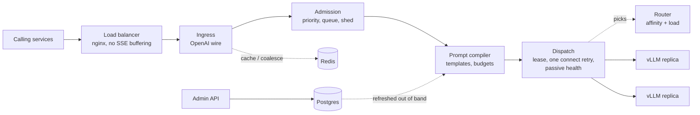

# Architecture

One Go binary, two surfaces: the **request path** (every call, optimized for microseconds and predictable memory) and the **admin API** (templates and policy; never touches a request).

## Request flow



Every stage can be bypassed. If a stage fails, the request continues to the next stage unchanged and the skip is recorded (fail open).

## Wire-compatibility notes

Places where the gateway's wire behaviour is deliberate and might surprise someone comparing it with vLLM directly:

- **401 before 404 under `/v1/`.** With `auth.enabled: true`, every `/v1/*` request is authenticated before routing. Without a valid token, unknown paths (`/v1/embeddings`) and wrong methods (`GET /v1/completions`) both return 401, so route names are not revealed. With a valid token they return 404 and 405. vLLM run with `--api-key` does the same for `/v1` paths. Paths outside `/v1/` return 404 without auth, and `/livez` and `/readyz` never need a token. The gateway's 401 body is OpenAI-style (`code` is `missing_api_key` or `invalid_api_key`), where vLLM returns `{"error":"Unauthorized"}`.
- **`Idempotency-Key` means the caller opted in to retries.** A caller's `Idempotency-Key` or `X-Idempotency-Key` header is forwarded unchanged. Go's `http.Transport` then treats the POST as replayable: if a reused keep-alive connection to the replica breaks after the request was written but before any response byte, the Transport resends it once to the same replica. vLLM does not deduplicate by this header, so the replica may start the generation twice, but the caller never sees duplicated output (no retry happens after response headers arrive). This counts as caller opt-in under the "never silently retry" rule. Without the header, the Transport only resends when nothing was written, which is always allowed.

## Components

| Component | Package | Milestone | State |
| --- | --- | --- | --- |
| Config loader | `internal/config` | M0 | Env vars + mounted YAML; no local disk state |
| Ingress / wire adapter | `internal/ingress` | M0 | None. SSE relay, disconnect propagation |
| Body index | `internal/bodyindex` | AD | None. A request body's top level, read and validated once: members with byte ranges, and the splices that return a fresh index. One per request, on the handler's stack; ingress, the coalescing key and context assembly read it |
| Upstream client pool | `internal/upstream` | M0 | Pooled HTTP/1.1 + keep-alive connections per replica |
| Replica discovery | `internal/discovery` | M0 | Static list now; DNS / Kubernetes endpoints later (interface) |
| Health and lifecycle | `internal/health` | M0 | Liveness (shallow), readiness (false while draining), graceful drain |
| Telemetry | `internal/telemetry` | M0 | Prometheus metrics, structured logs, trace IDs; never prompt text |
| Caller auth | `internal/auth` | M0 | Per-service tokens from config |
| Router | `internal/router` | M1 | Affinity key → replica via consistent hashing with bounded load; picks a replica and its in-flight slot (a lease), never sends |
| Dispatch | `internal/dispatch` | M1 | Sends a request to the replica the router picks and returns at response headers: the lease, the one connect retry (ADR 0014), passive health reports, the stuck-engine watch, in-flight telemetry |
| Load view | `internal/loadview` | M1 | Gateway in-flight counts + scraped vLLM `/metrics` |
| Admission controller | `internal/admission` | M2 | Priority queues, shedding, retry hints; counters in Redis |
| Template registry client | `internal/templates` | M3 | In-memory snapshot of Postgres, refreshed out of band |
| Prompt compiler | `internal/compiler` | M3 | Segment ordering, exact token counts |
| Tokenizer | `internal/tokenizer` | M3 | HuggingFace tokenizers via cgo; never reimplemented |
| Dedup policy | `internal/dedup` | M4 | Whether a templated request follows a running flight, is served from the cache or leads, under which keys; whether the leader's response is stored, from what its relay delivered |
| Coalescer | `internal/coalesce` | M4 | In-flight dedup with replay + ref-counted cancellation |
| Response cache | `internal/respcache` | M4 | Redis, TTL per template, memory ceiling |
| Context assembler | `internal/contextbudget` | M4 | Token-budgeted packing, reports drops |
| Admin API | `internal/admin` | M3 | CRUD over registry and policy (Postgres) |

## Telemetry notes

- `gateway_requests_total{status}` carries the final HTTP status, or an outcome when a response fails after its status line was sent: `aborted` (handler panic), `stream_error` (upstream failed mid-response; one SSE error event was sent) and `client_closed` (the caller disconnected mid-response). A disconnect before headers is `499`. The dashboard's error ratio counts 5xx, `aborted` and `stream_error`.
- `gateway_retries_total{pool,reason}` counts the single retry allowed before any byte is sent upstream. It is the retry signal; `gateway_route_decisions_total` (M1) stays about routing policy decisions.

## Repository layout

```
gateway/
  cmd/gateway/          main: wires config, servers, signals
  cmd/mockllm/          OpenAI-compatible mock upstream for GPU-less dev and CI
  internal/...          packages above
harness/
  cmd/loadgen/          load generator
  profiles/*.yaml       synthetic workload profiles
deploy/compose/
  docker-compose.yml    profiles: dev (mock), gpu (vLLM)
  nginx/ prometheus/ grafana/
docs/
Makefile
```

## Deployment (now): single-server Docker Compose

| Service | Count | Notes |
| --- | --- | --- |
| nginx | 1 | `proxy_buffering off`, long read timeouts, high worker connections; consistent hash on `X-Template-Id` so a template's requests reach one gateway and coalesce (ADR 0020). A Kubernetes ingress must route the same way. |
| gateway | 2 | Restarts without downtime; `ulimits.nofile` raised |
| vllm-large | 1 per GPU group | `--enable-prefix-caching`, `--scheduling-policy priority` |
| vllm-small | ≥1 | Classification / extraction tier |
| mockllm | dev profile only | Replaces vLLM for local work |
| redis | 1 | `maxmemory` + eviction policy set |
| postgres | 1 | Persistent volume |
| prometheus, grafana | 1 each | Dashboards for harness and prod |

## Kubernetes-readiness (built in, not deployed)

- Discovery and routing behind interfaces.
- Config only from env and mounted files.
- Liveness vs. readiness split; SIGTERM → stop accepting, drain streams up to a timeout, exit.
- No local state beyond read-only tokenizer files.
